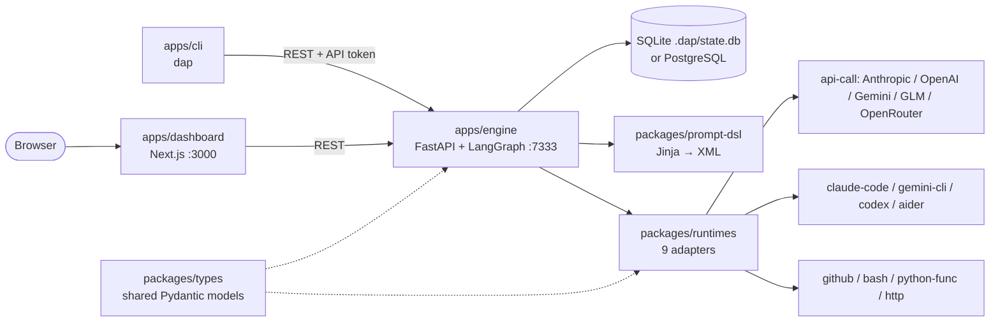

# DAP — Deterministic Agent Pipeline

[](https://github.com/lagowski/dap/actions/workflows/ci.yml)
[](LICENSE)
[](https://www.python.org/downloads/)
[](https://github.com/astral-sh/ruff)
[](https://mypy-lang.org/)
[](https://codecov.io/gh/lagowski/dap)
[](https://github.com/lagowski/dap/actions/workflows/codeql.yml)

> **Project status (2026-11-03):** active development. The latest tagged release is
> **v0.3.0** (2026-05-12, on PyPI as `dap-cli` and on GHCR as `ghcr.io/lagowski/dap`).
> `develop` is well ahead of that tag: projects and the `dap project` terminal workflow,
> backend profiles and fallback chains, retry loops and workspace state, the `github` and
> `aider` runtimes, the instance env-var store and the interaction log are all merged, but
> not yet in a tagged release (see [CHANGELOG.md](CHANGELOG.md) → *Unreleased*).
> **DAP is self-hosted only. There is no public hosted service.** You run the engine and
> dashboard on your own machine or server. The maintainers run a private instance of
> `develop` for their own pipelines.

## Description

DAP is a self-hostable, multi-user system for building and running **deterministic agent
pipelines**. A pipeline is a versioned DAG of agents. Each agent renders a Jinja → XML
prompt and sends it to a runtime adapter: the Anthropic, OpenAI, Gemini, GLM or OpenRouter
SDKs; the claude-code, gemini-cli, codex or aider CLIs; GitHub operations; plain bash; an
in-process Python function; or HTTP. Execution runs on LangGraph with pause, resume, abort,
retry and skip, live progress for each node, and human approval gates. The design is
anti-emergent: the state machine decides what runs next, never the model.

## Visuals

### What has been built

```mermaid
flowchart LR
  subgraph R1["v0.0.1 — single-user"]
    a1[Engine: FastAPI + LangGraph + SQLite]
    a2[Next.js dashboard + React Flow designer]
    a3[prompt-dsl: Jinja → XML]
  end
  subgraph R3["v0.3.0 — multi-user (2026-05-12)"]
    b1[A: auth + ownership]
    b2[B: dashboard login flow]
    b3[C: admin panel — users, audit log, API tokens]
    b4[D: PyPI wheel + Docker image]
    b5[E: auto-migration from 0.0.1]
  end
  subgraph DEV["develop — unreleased"]
    c1[Projects + dap project CLI]
    c2[Live run progress, finalize → gate routing]
    c3[Backend profiles, private template registry]
    c4[Postgres + Alembic, instance env-var store, interaction log]
    c5["#810: git workspace + push guards, github runtime"]
    c6["#811: retry loops, workspace diff state, fallback chains"]
    c7["#929: aider runtime"]
  end
  R1 --> R3 --> DEV
```



### How the parts fit together



## Installation

There are three supported install paths, from simplest to most involved:

1. **PyPI**: `pipx install dap-cli && dap init --admin-email=you@example.com && dap start`.
   This runs on a single machine. The wheel bundles the Next.js dashboard. `dap start`
   starts the dashboard alongside the engine when `node` is on `PATH`, and otherwise runs
   the engine only (the CLI prints a hint).
2. **Docker**: `ghcr.io/lagowski/dap:0.3.0`, for shared or production deployments.
   [`examples/standalone/`](examples/standalone/) has a working compose file, with SQLite
   (the default) or Postgres.
3. **Source**: for contributors, and the only way to get what's on `develop`. See below.

**Installing for the first time?** [**docs/quick-start.md**](docs/quick-start.md) helps you
pick a path with three questions, then gives copy-paste commands for it. For deployment, the
production checklist and troubleshooting, see [docs/self-hosting.md](docs/self-hosting.md).
For local-only, LAN and SSH tunnel setups, see [DEPLOYMENT.md](DEPLOYMENT.md).

### Requirements (source install)

- Python 3.13+ (`.python-version` pins 3.13)
- [uv](https://docs.astral.sh/uv/) 0.8+
- Node 22+
- pnpm 9+

`scripts/setup` checks all four for you. To install them yourself:
`pyenv install 3.13 && pyenv local 3.13`, `curl -LsSf https://astral.sh/uv/install.sh | sh`,
`nvm install 22 && nvm use 22`, `corepack enable && corepack prepare pnpm@9.15.9 --activate`.

Optional, depending on the runtimes you use: the `claude`, `gemini`, `codex` or `aider`
CLIs on `PATH`, and `gh auth login` for the example bundles that call GitHub.

### Install from source

```bash
git clone https://github.com/lagowski/dap && cd dap
./scripts/setup
```

`scripts/setup` is idempotent. It:

1. Checks the Python, uv, Node and pnpm versions. A missing or too-old tool fails with a
   one-line install hint.
2. Copies `.env.example` to `.env.local` if `.env.local` doesn't exist. `.env.local` is
   gitignored, so your provider keys stay local.
3. Runs `uv sync --all-packages`, which installs the Python deps for the engine, runtimes,
   types, prompt-dsl and CLI.
4. Runs `pnpm install` in `apps/dashboard`.
5. Turns on `.githooks/pre-push`, which blocks accidental pushes to `main` and `develop`.

When it finishes, edit `.env.local` and add at least one provider key (see
[Configuration](#configuration)).

### Upgrading from 0.0.1

v0.3.0 adds multi-user auth on top of the existing engine. The first time it starts against
a pre-v0.3 `.dap/state.db`, the auto-migration creates a `legacy-admin@local` admin and
**prints the generated password once, on stdout**:

```
Migrated single-user install. Bootstrap admin: legacy-admin@local
with password=<random>. Change immediately at /admin/users.
```

Copy the password from the engine log on first boot. If you missed it, run
`dap init --force --admin-email=legacy-admin@local --admin-password=<new>`: it gives the
existing admin row the new password. Existing pipelines, agents, projects and runs are kept
and owned by the legacy admin. Reassign them from `/admin/users` as your team joins.

Scripts that call `localhost:7333` without auth now need an API token: mint one at
`/admin/api-tokens`, then send `Authorization: Bearer dap_*`. See
[docs/auth.md](docs/auth.md#api-tokens) for the token lifecycle.

## Usage

### Run the stack

```bash
./scripts/dev
```

This starts the engine on `http://127.0.0.1:7333` and the dashboard on
`http://localhost:3000` in one terminal. Each log line is prefixed `[engine]` or
`[dashboard]`, and Ctrl+C stops both. `./scripts/dev --install` runs `scripts/setup` first,
then starts both.

To run each side in its own terminal (useful when debugging one of them):

```bash
# 1. Backend: engine + CLI + runtimes
uv sync --all-packages
set -a; source .env.local; set +a
uv run dap-engine                         # binds 127.0.0.1:7333

# 2. Dashboard, in a second terminal
cd apps/dashboard
pnpm dev                                  # http://localhost:3000
```

With the PyPI install, use `dap start`, `dap stop` and `dap status` instead.

### First pipeline

The repo ships an importable example bundle that exercises the whole stack:

1. Open `http://localhost:3000/pipelines` and click **Import JSON**.
2. Pick `examples/pipelines/github-issue-triage.pipeline-bundle.json`.
3. The engine creates the bundled agents (one bash, two GLM api-call, two more bash) and
   wires them into a 5-node DAG
   (`fetch_issues → select_issue → load_prd → enrich → create_branch`). You land on
   `/pipelines/<id>/edit`.
4. Click **Run**. The page redirects to the live run view, which shows each node's status,
   prompt, output and cost as it runs.

This bundle needs `gh auth login` on the host, `GLM_API_KEY` in `.env.local`, and a
`docs/PRD.md` in the repo the engine is started from. Other bundles in
[`examples/pipelines/`](examples/pipelines/): `github-read-issue-comment` (the `github`
runtime), `tester-coder-retry` (retry loops), `team-collaboration` and
`cortex-github-issue`. Everything stays editable from the dashboard once it's imported.

### Agents

Each agent has:

- A **runtime**: `api-call` for SDK calls; `claude-code`, `gemini-cli`, `codex` or `aider`
  for agentic CLIs; `github` for declarative GitHub reads and writes (read issue/PR,
  comment, update an issue section, create a branch, open a PR, merge a PR pinned to its
  head sha); `bash` for shell; `python-func` for an in-process Python callable; `http` for
  any REST call.
- A **prompt template** (Jinja → XML, validated against `PipelineState`).
- An **`input_schema`** and **`output_schema`** that declare which `PipelineState` fields it
  reads and writes.
- A **role** (`task_selector`, `prompt_builder`, `test_author`, `implementer`, `verifier`,
  `post_check`, or any custom string).

**Test panel (dry run).** On `/agents/<id>/edit` or `/agents/new`, the **Test** panel runs
the agent against sample state without saving anything: no `Run` row, no
`NodeExecutionLog`, no state-machine effects. It shows the rendered XML prompt, the runtime's
real output, and a soft check of that output against `output_schema`. Each dry run is capped
by `DAP_DRY_RUN_BUDGET_USD` (default $0.50). `POST /agents/dry-run` does the same from code.

**Render preview.** `POST /agents/<id>/render-preview` compiles the prompt against sample
state and returns the XML without calling the runtime. It catches Jinja errors and undefined
variables before you spend tokens.

**Archive.** `/agents` has an **Archive** action. The engine refuses with HTTP 409 while any
non-archived pipeline still uses the agent, and lists those pipelines. Archiving is soft:
run history keeps the reference, and the agent leaves the pickers and the active list.

**Versions.** Every save bumps the agent's version, and `/agents/<id>/versions` lists them.
A pipeline pins the agent's current version when you save the pipeline.

### Pipelines

`/pipelines/new` and `/pipelines/<id>/edit` open the React Flow designer:

- Drag agents from the picker onto the canvas and wire edges. Conditional edges support
  `field == value`, `field != value`, `is_null`, `not`, and more, against `PipelineState`.
- The Inspector (right side) shows the agent's prompt, schemas and runtime config, plus a
  **State after this node** view: the combined `output_schema` of every upstream agent.
- **Validate** checks that every declared `input_schema` field is written by some upstream
  node.
- Retry loops, workspace diff state and backend fallback chains are covered in
  [docs/pipelines.md](docs/pipelines.md).

**Run a pipeline.** From `/pipelines`, **Run** opens a dialog for optional `initial_state`
JSON, starts the run and redirects to `/runs/<id>`. That page shows live progress (the
running node, a status timeline for each node, the current phase) by polling
`GET /runs/<id>`. You can **Pause**, **Resume** or **Abort** a running run. On a failed,
paused or aborted run, click a node and pick **Retry** (run it again) or **Skip** (mark it
done and move on).

From a terminal, `dap project run cortex <issue-url>` starts a pipeline run for a GitHub
issue (`cortex` is currently the only pipeline type), and `dap project approve`, `reject`
and `state` drive it from there. They take `--engine` (or `DAP_ENGINE_URL`)
and an API token (or `DAP_AUTH_TOKEN`). See [docs/projects.md](docs/projects.md).

**Approval gates.** A pipeline can mark nodes as needing human approval
(`defaults.approval_required_nodes`). When a run reaches one, it pauses and shows the gate
payload inline (task assignments, the spec, and any non-blocking `finalize_warnings`), so you
can **Approve** or **Reject** without reading logs. A finalize node that emits "READY" goes
to a gate that can be auto-approved; "NEEDS_WORK" goes to one that needs a human. A pipeline
that sets `defaults.requires_terminal_final_status` is marked failed, not successful, if it
ends without reaching a terminal state.

### Logs

Every node execution writes a row to `node_execution_logs` (in `./.dap/state.db`, or in
Postgres when `DAP_DATABASE_URL` is set):

| Column | Content |
|---|---|
| `prompt_xml` | The exact prompt sent to the runtime (after Jinja) |
| `stdout` / `stderr` | Raw runtime output |
| `output_json` | The parsed `<output>{…}</output>` block |
| `tokens_used` / `cost_usd` / `duration_ms` | Telemetry |
| `status` / `error_message` | success / failed / timeout / abort |

Inspect them in the dashboard (`/runs/<id>`, click a node), through the API
(`GET /runs/<id>/nodes/<node_id>`), or directly with
`sqlite3 .dap/state.db "select * from node_execution_logs where run_id = '<id>';"`.
State snapshots after each node are in `state_snapshots`, and the run summary is in
`runs.node_statuses`. The engine API reference is at `http://127.0.0.1:7333/docs` while the
engine runs.

## Configuration

The engine reads its settings from the process environment at startup only, so restart it
after a change. `scripts/dev` loads `.env.local`. [`.env.example`](.env.example) has the
commented template, and [docs/self-hosting.md](docs/self-hosting.md) explains each setting
for production.

### Engine

| Variable | Default | Purpose |
|---|---|---|
| `DAP_ENGINE_HOST` | `127.0.0.1` | Listen address. Use `0.0.0.0` in containers. |
| `DAP_ENGINE_PORT` | `7333` | Listen port. |
| `DAP_LOG_LEVEL` | `INFO` | Engine log level. An unknown name stops startup. |
| `DAP_DB_PATH` | `./.dap/state.db` | SQLite file. Its directory is created if missing. |
| `DAP_DATABASE_URL` | unset | `postgresql+asyncpg://…` switches to Postgres and overrides `DAP_DB_PATH`. Migrations run at startup. |
| `DAP_PG_POOL_MIN_SIZE` / `DAP_PG_POOL_MAX_SIZE` | `4` / `10` | Postgres checkpointer pool size. |
| `DAP_PG_POOL_RECONNECT_TIMEOUT` | `300` | Seconds the Postgres pool keeps trying to reconnect. |
| `DAP_CORS_ORIGINS` | local dev origins | Comma-separated origins allowed to call the engine. **Set in production.** |
| `DAP_DRY_RUN_BUDGET_USD` | `0.50` | Cost cap for each dry run in the agent Test panel. |
| `DAP_BASH_SHELL` | `/bin/bash` | Shell for the `bash` runtime (agents can override with `runtime_config.shell`). |
| `DAP_ALLOW_BASH_RUNTIME_FOR_NON_ADMIN` | off | `1` lets non-admin users run `bash` agents. These run with the engine's privileges. |
| `DAP_PYTHON_FUNC_MAX_WORKERS` | `10` | Worker threads for the `python-func` runtime. |
| `DAP_INSTANCE_ENV_VARS_KEY` | unset | Fernet key for the encrypted instance env-var store (`/admin` settings). Without it, writing an env var returns 503. Must stay the same across restarts. |
| `DAP_INTERACTION_LOG_ENABLED` | `1` | Records model interactions in `interaction_log`. `0` turns it off. |
| `DAP_INTERACTION_LOG_RETENTION_DAYS` | `90` | Days kept; purged at startup. `0` or negative keeps them forever. |
| `DAP_TEMPLATE_REGISTRY_ALLOWED_HOSTS` | empty (off) | Comma-separated hosts that `POST /pipelines/import-from-url` may fetch bundles from. |
| `DAP_TEMPLATE_REGISTRY_AUTH_TOKEN` | unset | Bearer token sent with those fetches. |
| `DAP_ASSISTANT_PROVIDER` / `DAP_ASSISTANT_MODEL` | first provider with a key | Provider and model for the configuration assistant. `claude-code` uses the host's `claude` login. `ASSISTANT_PROVIDER` / `ASSISTANT_MODEL` also work as instance env vars. |

### Auth

| Variable | Default | Purpose |
|---|---|---|
| `DAP_AUTH_JWT_SECRET` | random per process | Signs dashboard session tokens. **Required** for anything that restarts or has more than one replica (`openssl rand -hex 32`). API tokens don't depend on it. |
| `DAP_AUTH_ACCESS_TTL_SECONDS` | `900` | Session token lifetime. |
| `DAP_AUTH_LOG_RESET_TOKENS` | off | `1` logs password-reset tokens, for installs without email. Keep it off in production. |
| `DAP_AUTH_OAUTH_REDIRECT_URL` | unset | After OAuth, the browser is redirected here with `?token=` (for example `http://localhost:3000/api/auth/oauth/callback`). Unset returns JSON. |
| `DAP_OAUTH_GITHUB_CLIENT_ID` / `_SECRET` | unset | Turns on GitHub login when both are set. |
| `DAP_OAUTH_GOOGLE_CLIENT_ID` / `_SECRET` | unset | Turns on Google login when both are set. |

### Provider keys

You only need keys for the providers you call:

| Provider | Env var | Used by |
|---|---|---|
| Anthropic | `ANTHROPIC_API_KEY` | `api-call` (provider=`anthropic`), `claude-code` CLI fallback |
| OpenAI | `OPENAI_API_KEY` | `api-call` (provider=`openai`), `codex` CLI |
| Google Gemini | `GEMINI_API_KEY` (or `GOOGLE_API_KEY` for the CLI) | `api-call` (provider=`gemini`), `gemini-cli` |
| Z.AI GLM | `GLM_API_KEY` | `api-call` (provider=`glm`) |
| OpenRouter | `OPENROUTER_API_KEY` | `api-call` (provider=`openrouter`), slash-namespaced model ids |

The `claude-code` and `gemini-cli` runtimes can also use their own logins (`claude` on a
Pro/Max plan, `gemini auth login`) instead of an API key. For any other OpenAI-compatible
provider (Together, internal proxies, Ollama), use `api-call` with `provider=openai-compat`,
set `api_key_env` and `base_url` in the agent's `runtime_config`, and export that env var.
See [docs/providers.md](docs/providers.md). The `bash` runtime needs no key, but **it runs
commands with the engine's privileges**. See the security note in
[packages/runtimes/README.md](packages/runtimes/README.md).

### CLI

| Variable | Purpose |
|---|---|
| `DAP_ENGINE_URL` | Engine base URL for `dap project …` (same as `--engine`). |
| `DAP_AUTH_TOKEN` | API token for `dap project …`. |

## Repository layout

```
apps/
  engine/      FastAPI + LangGraph + SQLAlchemy + Alembic: runs pipelines, serves the REST API
  dashboard/   Next.js 16 + React 19 + React Flow + TanStack Query: designer and run viewer
  cli/         Typer CLI `dap` (init, start, stop, status, project run/approve/reject/state)
packages/
  types/                Shared Pydantic types (Agent, Pipeline, Run, PipelineState, RuntimeTask)
  runtimes/             The 9 runtime adapters (api-call has 5 built-in providers + openai-compat)
  prompt-dsl/           Jinja2 → XML prompt compiler with sandboxing and schema validation
  database/             Shared SQLAlchemy engine and session factories (SQLite WAL / PostgreSQL)
  code-review-council/  Multi-agent PR reviewer (security/correctness/db/perf/frontend + arbiter);
                        currently not run by any CI workflow
examples/
  pipelines/            Importable .pipeline-bundle.json examples
  python-func-pipeline/ Runnable python-func pipeline example (logic package + bundle JSON)
  ops-pipeline/         Bundle for command-execution issues
  standalone/           Docker compose file for the standalone install
scripts/
  setup        First-run installer (version checks, .env, deps, hooks)
  dev          Day-to-day launcher (engine + dashboard, combined logs)
tests/smoke/   Cross-package end-to-end tests (FastAPI TestClient + real adapters)
e2e/           Playwright browser e2e (see e2e/COVERAGE.md for scope)
```

### Architectural invariants

1. **LangGraph controls flow; runtimes run steps.** Edges and conditions live in the
   pipeline definition, not in agents.
2. **Prompts are code.** They are compiled from a template plus a state projection,
   validated against an XML schema, and versioned per agent.
3. **State is the single source of truth.** Adapter output is parsed into a state diff.
   Nothing outside `PipelineState` survives from one node to the next.
4. **Autonomy is local, not global.** A runtime may use tools internally, but never decides
   what runs next in the pipeline.
5. **Runtimes execute; they don't plan.** Even agentic runtimes (`claude-code`, `codex`,
   `aider`) get compiled XML with an explicit task and an output contract.

### Documentation

- [docs/quick-start.md](docs/quick-start.md): pick an install path. **Start here.**
- [DEPLOYMENT.md](DEPLOYMENT.md): local-only, LAN and SSH tunnel setups.
- [docs/self-hosting.md](docs/self-hosting.md): deployment paths, production checklist,
  OAuth, troubleshooting.
- [docs/auth.md](docs/auth.md): email+password, GitHub and Google OAuth, API tokens.
- [docs/admin-guide.md](docs/admin-guide.md): `/admin/*` (users, audit log, API tokens) and
  recovery procedures.
- [docs/security.md](docs/security.md): threat model, secrets handling, auth internals,
  reverse-proxy hardening, what's out of scope.
- [docs/architecture.md](docs/architecture.md): packages, service layer, state schema, run
  lifecycle, LangGraph checkpoints.
- [docs/projects.md](docs/projects.md): projects, workflow kinds, env layering.
- [docs/providers.md](docs/providers.md) and [docs/runtimes.md](docs/runtimes.md): the
  provider matrix, and how to add a runtime adapter.
- [docs/pipelines.md](docs/pipelines.md): retry loops, workspace diff state, `not`
  conditions, backend fallback chains.
- [docs/python-func-pipelines.md](docs/python-func-pipelines.md): pipelines whose nodes run
  your own Python code.
- [docs/database-migrations.md](docs/database-migrations.md),
  [docs/database-indexes.md](docs/database-indexes.md),
  [docs/dependency-updates.md](docs/dependency-updates.md),
  [docs/testing.md](docs/testing.md), [docs/release.md](docs/release.md).
- [packages/runtimes/README.md](packages/runtimes/README.md): config reference for each
  runtime.

## Roadmap

Open work is tracked in [GitHub issues](https://github.com/lagowski/dap/issues):

- **Native declarative runtimes** (#776, tracking): express cortex-class pipelines as JSON
  with less reliance on `python-func`. Next slice: a tool-loop `agent` runtime that uses the
  built-in runtimes as tools (#813).
- **Project-bootstrap bundle** (#797): import and run-verify it end to end.
- **Code review council** (#633, tracking): evaluate a line-by-line code-style specialist.
- **Next release**: tag what is on `develop` (everything after v0.3.0). The release pipeline
  is described in [docs/release.md](docs/release.md).

## Contributing

See [CONTRIBUTING.md](CONTRIBUTING.md) for the full rules. In short:

- Branch from `develop` (`issue/<number>-<slug>`), open a PR against `develop`, and merge
  only when CI is green. `develop → main` PRs are releases. Never push directly to `main` or
  `develop`; the pre-push hook and branch protection both block it.
- Every issue gets `type:`, `area:` and `size:` labels when it's created.
- CI (`.github/workflows/ci.yml`) runs ruff (lint and format), mypy, pytest with coverage,
  three smoke shards, a pip-audit CVE scan, and the dashboard's API-type drift check,
  typecheck, lint, tests and build. CodeQL and e2e run in their own workflows.

Run the same checks locally:

```bash
# Python (repo root)
uv run ruff check apps packages tests
uv run ruff format --check apps packages tests
uv run mypy apps packages tests
uv run pytest -q -m "not integration" --ignore=tests/standalone  # fast gate
uv run pytest -q -m integration tests/smoke                       # smoke integration

# Dashboard (apps/dashboard)
pnpm check:api      # generated API types match the engine's OpenAPI (pnpm gen:api to fix)
pnpm typecheck
pnpm lint
pnpm test
pnpm build

# Browser e2e (e2e/)
npx playwright test --project=app
```

## License

DAP is released under the [MIT License](LICENSE).

Copyright © 2026 **Rafał Łagowski** ([LinkedIn](https://www.linkedin.com/in/rafallagowski/)) and **Daniel Łagowski** ([LinkedIn](https://www.linkedin.com/in/daniellagowski/)).

MIT is permissive: you may use, copy, modify and distribute the software freely, **but the
copyright and permission notice above must be kept in all copies or substantial portions of
the Software**. In practice, if you use or redistribute DAP (or any of its packages), keep
the `LICENSE` file and this attribution to the authors.
