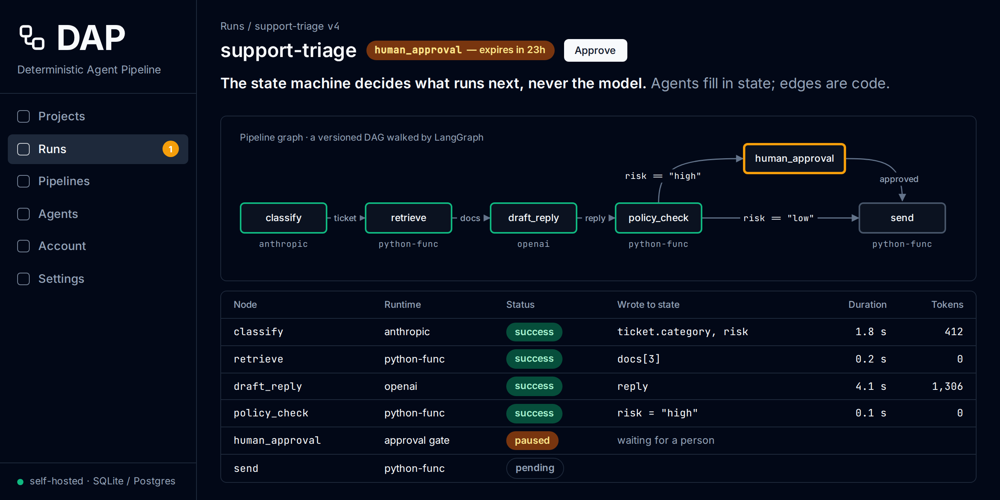
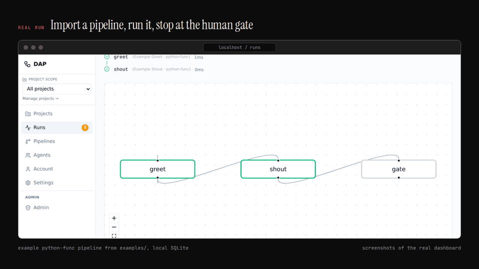
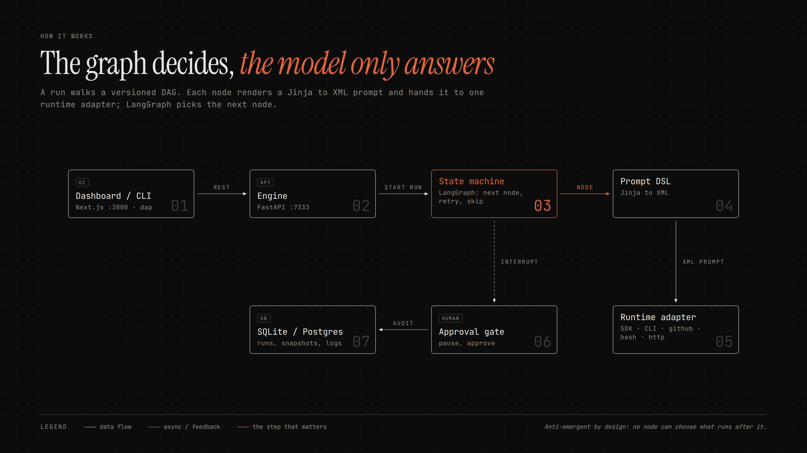
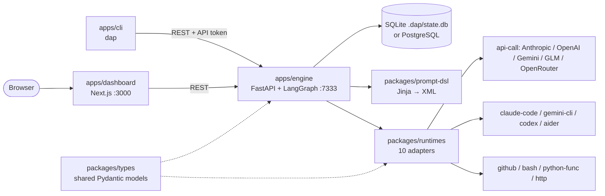
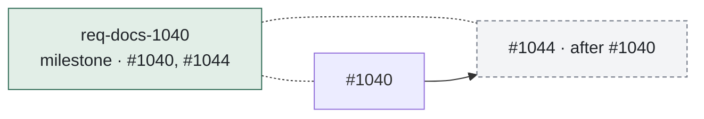

<p align="center"><a href="docs/quick-start.md"><picture>
  <source media="(prefers-color-scheme: light)" srcset="docs/images/banner-light.png">
  
</picture></a></p>

<p align="center"><b>Deterministic agent pipelines: the state machine decides what runs next, never the model.</b><br>
<a href="#installation">Install</a> · <a href="#demo">Demo</a> · <a href="#how-it-works">How it works</a> · <a href="docs/architecture.md">Docs</a> · <a href="docs/why-dap.md">Why DAP</a></p>

<p align="center">
<a href="https://github.com/lagowski/dap/actions/workflows/ci.yml"></a>
<a href="https://pypi.org/project/dap-cli/"></a>
<a href="LICENSE"></a>


</p>

# DAP — Deterministic Agent Pipeline

## Demo

<p align="center"></p>

<sub>Screenshots of the real dashboard running the example python-func pipeline from <code>examples/</code> on local SQLite.</sub>

## How it works

<p align="center"></p>

The dashboard and CLI talk REST to the FastAPI engine. LangGraph walks the versioned DAG and picks every next node;
each node renders a Jinja to XML prompt and hands it to one runtime adapter. Approval gates interrupt the run until a
human approves, and every step is stored in SQLite or Postgres.

> **Project status:** active development. The latest tagged release is **v0.3.0** (on PyPI as
> `dap-cli` and on GHCR as `ghcr.io/lagowski/dap`); `develop` is well ahead of that tag (see
> [CHANGELOG.md](CHANGELOG.md) → *Unreleased* and the release map in
> [docs/architecture.md](docs/architecture.md#what-has-been-built)).
> **DAP is self-hosted only. There is no public hosted service.** You run the engine and
> dashboard on your own machine or server.

## Description

DAP is a self-hostable, multi-user system for building and running **deterministic agent
pipelines**. A pipeline is a versioned DAG of agents. Each agent renders a Jinja → XML
prompt and sends it to a runtime adapter: the Anthropic, OpenAI, Gemini, GLM or OpenRouter
SDKs; the claude-code, gemini-cli, codex or aider CLIs; GitHub operations; plain bash; an
in-process Python function; or HTTP. Execution runs on LangGraph with pause, resume, abort,
retry and skip, live progress for each node, and human approval gates. The design is
anti-emergent: the state machine decides what runs next, never the model.

## Visuals

### How the parts fit together



## Installation

There are three supported install paths, from simplest to most involved:

1. **PyPI**: `pipx install dap-cli && dap init --admin-email=you@example.com && dap start`.
   This runs on a single machine. The wheel bundles the Next.js dashboard. `dap start`
   starts the dashboard alongside the engine when `node` is on `PATH`, and otherwise runs
   the engine only (the CLI prints a hint).
2. **Docker**: `ghcr.io/lagowski/dap:0.3.0`, for shared or production deployments.
   [`examples/standalone/`](examples/standalone/) has a working compose file, with SQLite
   (the default) or Postgres.
3. **Source**: for contributors, and the only way to get what's on `develop`. See below.

**Installing for the first time?** [**docs/quick-start.md**](docs/quick-start.md) helps you
pick a path with three questions, then gives copy-paste commands for it. For deployment, the
production checklist and troubleshooting, see [docs/self-hosting.md](docs/self-hosting.md).
For local-only, LAN and SSH tunnel setups, see [DEPLOYMENT.md](DEPLOYMENT.md).

### Requirements (source install)

- Python 3.13+ (`.python-version` pins 3.13)
- [uv](https://docs.astral.sh/uv/) 0.8+
- Node 22+
- pnpm 9+

`scripts/setup` checks all four for you. To install them yourself:
`pyenv install 3.13 && pyenv local 3.13`, `curl -LsSf https://astral.sh/uv/install.sh | sh`,
`nvm install 22 && nvm use 22`, `corepack enable && corepack prepare pnpm@9.15.9 --activate`.

Optional, depending on the runtimes you use: the `claude`, `gemini`, `codex` or `aider`
CLIs on `PATH`, and `gh auth login` for the example bundles that call GitHub.

### Install from source

```bash
git clone https://github.com/lagowski/dap && cd dap
./scripts/setup
```

`scripts/setup` is idempotent. It:

1. Checks the Python, uv, Node and pnpm versions. A missing or too-old tool fails with a
   one-line install hint.
2. Copies `.env.example` to `.env.local` if `.env.local` doesn't exist. `.env.local` is
   gitignored, so your provider keys stay local.
3. Runs `uv sync --all-packages`, which installs the Python deps for the engine, runtimes,
   types, prompt-dsl and CLI.
4. Runs `pnpm install` in `apps/dashboard`.
5. Turns on `.githooks/pre-push`, which blocks accidental pushes to `main` and `develop`.

When it finishes, edit `.env.local` and add at least one provider key (see
[Configuration](#configuration)).

### Upgrading from 0.0.1

v0.3.0 adds multi-user auth. The first start against a pre-v0.3 `.dap/state.db` creates a
`legacy-admin@local` admin and prints its generated password **once**, on stdout; scripts
that called `localhost:7333` without auth then need an API token. The steps are in
[docs/self-hosting.md](docs/self-hosting.md#upgrading-from-001).

## Usage

### Run the stack

```bash
./scripts/dev
```

This starts the engine on `http://127.0.0.1:7333` and the dashboard on
`http://localhost:3000` in one terminal. Each log line is prefixed `[engine]` or
`[dashboard]`, and Ctrl+C stops both. `./scripts/dev --install` runs `scripts/setup` first,
then starts both.

To run each side in its own terminal (useful when debugging one of them):

```bash
# 1. Backend: engine + CLI + runtimes
uv sync --all-packages
set -a; source .env.local; set +a
uv run dap-engine                         # binds 127.0.0.1:7333

# 2. Dashboard, in a second terminal
cd apps/dashboard
pnpm dev                                  # http://localhost:3000
```

With the PyPI install, use `dap start`, `dap stop` and `dap status` instead.

### First pipeline (no API key)

The first pipeline runs your own Python, so it needs no API key, no `gh auth` and no
extra files. It is [`examples/python-func-pipeline`](examples/python-func-pipeline/), the
one in the demo: `greet → shout → gate → end`.

1. Stop the stack if it is running, install the example package into the engine venv, then
   start the stack again (the engine imports the node code from its own venv):

   ```bash
   uv pip install -e examples/python-func-pipeline
   ./scripts/dev
   ```

2. Open `http://localhost:3000/pipelines`, click **Import JSON** and pick
   `examples/python-func-pipeline/example.pipeline-bundle.json`. The engine creates three
   `python-func` agents and wires them into the DAG. You land on `/pipelines/<id>/edit`.
3. Click **Run**. The live run view shows `greet` and `shout` finish, then the run waits at
   the `gate` node for a human.
4. Approve the gate. The run ends with status `success` and `extensions.greeting_loud` set
   to `HELLO, WORLD!`.

How the nodes are written: [`docs/python-func-pipelines.md`](docs/python-func-pipelines.md).

### Second pipeline: with real tools

`examples/pipelines/github-issue-triage.pipeline-bundle.json` calls GitHub and an LLM. Before
you import it you need:

- `gh auth login` on the host (its `bash` nodes run `gh`),
- `GLM_API_KEY` in `.env.local` (its two `api-call` nodes use GLM), then restart the engine,
- a `docs/PRD.md` in the repo the engine is started from.

Import it the same way. The engine creates the bundled agents (one bash, two GLM api-call,
two more bash) and wires them into a 5-node DAG
(`fetch_issues → select_issue → load_prd → enrich → create_branch`). Click **Run**. The
live run view shows each node's status, prompt, output and cost as it runs.

Other bundles in [`examples/pipelines/`](examples/pipelines/): `github-read-issue-comment`
(the `github` runtime), `tester-coder-retry` (retry loops), `team-collaboration` and
`cortex-github-issue`. Everything stays editable from the dashboard once it's imported.

### Agents, pipelines and logs

An agent is a runtime plus a prompt template, input/output schemas and a role; a pipeline
wires agents into a DAG in the React Flow designer (`/pipelines/new`), with conditional
edges, retry loops, approval gates and fallback chains. Every node execution is logged with
its exact prompt, output, tokens and cost. From a terminal, `dap project run`, `approve`,
`reject` and `state` drive a run.

- [docs/usage.md](docs/usage.md): agents (test panel, render preview, archive, versions),
  pipelines (designer, running, approval gates) and logs.
- [docs/pipelines.md](docs/pipelines.md): retry loops, workspace diff state, fallback chains.
- [docs/projects.md](docs/projects.md): projects and the `dap project` workflow.

## Configuration

The engine reads its settings from the process environment at startup only, so restart it
after a change. `scripts/dev` loads `.env.local`; [`.env.example`](.env.example) has the
commented template. To start you need one provider key for the providers you call
(`ANTHROPIC_API_KEY`, `OPENAI_API_KEY`, `GEMINI_API_KEY`, `GLM_API_KEY` or
`OPENROUTER_API_KEY`), and `DAP_AUTH_JWT_SECRET` for anything that restarts or has more than
one replica. Every engine, auth, provider and CLI variable with its default is in
[docs/configuration.md](docs/configuration.md); [docs/self-hosting.md](docs/self-hosting.md)
explains the production settings.

## Repository layout

```
apps/
  engine/      FastAPI + LangGraph + SQLAlchemy + Alembic: runs pipelines, serves the REST API
  dashboard/   Next.js 16 + React 19 + React Flow + TanStack Query: designer and run viewer
  cli/         Typer CLI `dap` (init, start, stop, status, project run/approve/reject/state)
packages/
  types/                Shared Pydantic types (Agent, Pipeline, Run, PipelineState, RuntimeTask)
  runtimes/             The 10 runtime adapters (api-call has 5 built-in providers + openai-compat)
  prompt-dsl/           Jinja2 → XML prompt compiler with sandboxing and schema validation
  database/             Shared SQLAlchemy engine and session factories (SQLite WAL / PostgreSQL)
  code-review-council/  Multi-agent PR reviewer (security/correctness/db/perf/frontend + arbiter);
                        currently not run by any CI workflow
examples/
  pipelines/            Importable .pipeline-bundle.json examples
  python-func-pipeline/ Runnable python-func pipeline example (logic package + bundle JSON)
  ops-pipeline/         Bundle for command-execution issues
  standalone/           Docker compose file for the standalone install
scripts/
  setup        First-run installer (version checks, .env, deps, hooks)
  dev          Day-to-day launcher (engine + dashboard, combined logs)
tests/smoke/   Cross-package end-to-end tests (FastAPI TestClient + real adapters)
e2e/           Playwright browser e2e (see e2e/COVERAGE.md for scope)
```

### Architectural invariants

1. **LangGraph controls flow; runtimes run steps.** Edges and conditions live in the
   pipeline definition, not in agents.
2. **Prompts are code.** They are compiled from a template plus a state projection,
   validated against an XML schema, and versioned per agent.
3. **State is the single source of truth.** Adapter output is parsed into a state diff.
   Nothing outside `PipelineState` survives from one node to the next.
4. **Autonomy is local, not global.** A runtime may use tools internally, but never decides
   what runs next in the pipeline.
5. **Runtimes execute; they don't plan.** Even agentic runtimes (`claude-code`, `codex`,
   `aider`) get compiled XML with an explicit task and an output contract.

### Documentation

- [docs/quick-start.md](docs/quick-start.md): pick an install path. **Start here.**
- [docs/why-dap.md](docs/why-dap.md): why DAP exists, a dated timeline of its design
  decisions, and what is in and out of scope.
- [DEPLOYMENT.md](DEPLOYMENT.md): local-only, LAN and SSH tunnel setups.
- [docs/self-hosting.md](docs/self-hosting.md): deployment paths, production checklist,
  OAuth, troubleshooting.
- [docs/auth.md](docs/auth.md): email+password, GitHub and Google OAuth, API tokens.
- [docs/admin-guide.md](docs/admin-guide.md): `/admin/*` (users, audit log, API tokens) and
  recovery procedures.
- [docs/security.md](docs/security.md): threat model, secrets handling, auth internals,
  reverse-proxy hardening, what's out of scope.
- [docs/architecture.md](docs/architecture.md): packages, service layer, state schema, run
  lifecycle, LangGraph checkpoints.
- [docs/usage.md](docs/usage.md): agents, pipelines, approval gates and logs in the dashboard.
- [docs/configuration.md](docs/configuration.md): every environment variable with its default.
- [docs/projects.md](docs/projects.md): projects, workflow kinds, env layering.
- [docs/providers.md](docs/providers.md) and [docs/runtimes.md](docs/runtimes.md): the
  provider matrix, and how to add a runtime adapter.
- [docs/pipelines.md](docs/pipelines.md): retry loops, workspace diff state, `not`
  conditions, backend fallback chains.
- [docs/python-func-pipelines.md](docs/python-func-pipelines.md): pipelines whose nodes run
  your own Python code.
- [docs/database-migrations.md](docs/database-migrations.md),
  [docs/database-indexes.md](docs/database-indexes.md),
  [docs/dependency-updates.md](docs/dependency-updates.md),
  [docs/testing.md](docs/testing.md), [docs/release.md](docs/release.md).
- [packages/runtimes/README.md](packages/runtimes/README.md): config reference for each
  runtime.

## Roadmap

Open work is tracked in [GitHub issues](https://github.com/lagowski/dap/issues); the release
pipeline is described in [docs/release.md](docs/release.md).

## Contributing

See [CONTRIBUTING.md](CONTRIBUTING.md) for the full rules. In short:

- Branch from `develop` (`issue/<number>-<slug>`), open a PR against `develop`, and merge
  only when CI is green. `develop → main` PRs are releases. Never push directly to `main` or
  `develop`; the pre-push hook and branch protection both block it.
- Every issue gets `type:`, `area:` and `size:` labels when it's created.
- CI (`.github/workflows/ci.yml`) runs ruff (lint and format), mypy, pytest with coverage,
  three smoke shards, a pip-audit CVE scan, and the dashboard's API-type drift check,
  typecheck, lint, tests and build. CodeQL and e2e run in their own workflows.
- An AI review (`.github/workflows/gemini-review.yml`, check `gemini-review`) runs on PRs
  into `develop` and `main`. A PR from a fork is reviewed after a maintainer adds the
  `safe-to-review` label.

Run the same checks locally:

```bash
# Python (repo root)
uv run ruff check apps packages tests
uv run ruff format --check apps packages tests
uv run mypy apps packages tests
uv run pytest -q -m "not integration" --ignore=tests/standalone  # fast gate
uv run pytest -q -m integration tests/smoke                       # smoke integration

# Dashboard (apps/dashboard)
pnpm check:api      # generated API types match the engine's OpenAPI (pnpm gen:api to fix)
pnpm typecheck
pnpm lint
pnpm test
pnpm build

# Browser e2e (e2e/)
npx playwright test --project=app
```

## License

DAP is released under the [MIT License](LICENSE).

Copyright © 2026 **Rafał Łagowski** ([LinkedIn](https://www.linkedin.com/in/rafallagowski/)) and **Daniel Łagowski** ([LinkedIn](https://www.linkedin.com/in/daniellagowski/)).

MIT is permissive: you may use, copy, modify and distribute the software freely, **but the
copyright and permission notice above must be kept in all copies or substantial portions of
the Software**. In practice, if you use or redistribute DAP (or any of its packages), keep
the `LICENSE` file and this attribution to the authors.

<!-- veracrew:delivery:start -->
## What has been delivered

_Generated by VeraCrew from its walk records for `lagowski/dap` on every promotion (#2169). Edits between these markers are overwritten._



| run | promoted | items delivered |
|---|---|---|
| req-docs-1040 (milestone) | 2026-11-27 | #1040 docs(readme): zero-key first pipeline first, fix runtime badge count, drop the stars badge<br>#1044 docs: "Why DAP": design notes with the project's timeline and a focused-scope statement |
<!-- veracrew:delivery:end -->
